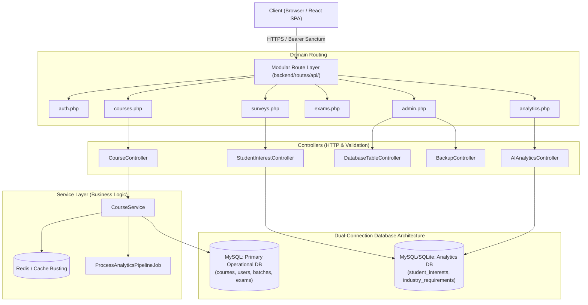

# CODL-SUSL: Distance Learning & Curriculum Intelligence Platform

[](https://laravel.com)
[](https://react.dev)
[](#backend-architecture)
[](#security-and-reliability-hardening)

An enterprise distance learning and academic workflow management system built for the **Centre for Open and Distance Learning (CODL)** at the **Sabaragamuwa University of Sri Lanka (SUSL)**. The platform orchestrates student enrollments, course life cycles, batch allocations, exam workflows, and an automated **NLP-driven Curriculum Intelligence & Industry Gap Analytics Pipeline**.

---

## Authorship, Collaboration & Contribution Notice

> [!NOTE]
> **Repository Context**: This repository is a fork representing ongoing work and architectural contributions to the CODL platform. The platform foundation was developed in collaboration with the university development team.

### My Engineering Contributions

As part of my core responsibilities on this project, I engineered and implemented:

1. **AI Analytics & NLP Curriculum Alignment Engine**:
   - Designed and engineered the end-to-end curriculum intelligence pipeline (`App\AI\Controllers\AIAnalyticsController`, `ProcessAnalyticsPipelineJob`, and associated analytical models `DomainClassification`, `IndustryRequirement`, and `StudentInterest`).
   - Implemented domain classification and keyword extraction heuristics to cross-analyze student career interests and emerging industry skill demands against university course syllabi.
   - Developed Google Sheets webhook integration with **HMAC-SHA256 signature verification** for automated ingest of external survey data.
   - Built the interactive frontend dashboard (`AIAnalytics.tsx`) with dynamic skill-gap visualizations, geographic demand heatmaps, and course recommendations.

2. **Backend Architecture Refactoring & Decoupling**:
   - **Extracted Monolithic Logic to Service Layer**: Refactored `CourseController` by extracting heavy curriculum operations, activity logging, queue dispatching, and cache invalidation into a dedicated, reusable `CourseService` (`App\Services\CourseService`).
   - **Modularized Route Architecture**: Decomposed the 220+ line monolithic `backend/routes/api.php` file into clean domain route registries under `backend/routes/api/` (`auth.php`, `courses.php`, `exams.php`, `surveys.php`, `admin.php`, `analytics.php`).

3. **Security Hardening & Defect Rectification**:
   - **Data Sanitization & Git Hygiene**: Removed legacy database backup dumps from git tracking and established comprehensive `.gitignore` filtering for databases, credentials, and backups.
   - **Fail-Closed Anti-Bot Protection**: Fixed `StudentInterestController` and `storeIndustry` reCAPTCHA verification to strictly **fail closed** upon verification failure or network timeouts, preventing automated bypass.
   - **Guaranteed Survey Persistence**: Resolved unpersisted survey submissions by ensuring all valid student interest and industry requirements are explicitly persisted to the analytics database.
   - **Protected Database Table Inspection**: Replaced arbitrary database table browsing with an explicit `ALLOWED_TABLES` allowlist and sensitive column filtering in `DatabaseTableController`.
   - **Exception Information Leaks**: Sanitized API error responses in `BackupController` to log stack traces internally while returning safe, generic error messages to clients.
   - **Docker Infrastructure Protection**: Parameterized fixed database passwords in `docker-compose.yml` into environment variables with an untracked template (`.env.docker.example`).

4. **Automated Testing Suite**:
   - Authored feature test suites validating survey persistence, anti-bot fail-closed behavior, allowlisted table access control, exception sanitization, and course life cycle workflows.

---

## Backend Architecture



### Key Architectural Patterns

- **Dual-Database Segregation**: High-volume, analytical survey aggregations and NLP matrices are isolated in an independent `analytics` database connection (`config/database.php`), protecting production transactional performance.
- **Service Layer Pattern**: Controllers validate input and authorize requests; complex multi-entity transactions (e.g. creating courses, synchronizing semesters, cascading subjects, logging activities, and queuing jobs) are encapsulated inside `CourseService`.
- **Versioned Cache Invalidation**: The course management interface uses versioned cache tags (`manage_course_version_{courseId}`) to allow instant, lock-free invalidation when curriculum items or instructors change.

---

## Security & Reliability Hardening

| Component | Security Concern | Mitigation Implemented |
|---|---|---|
| **`docker-compose.yml`** | Plaintext database root credentials in source control. | Replaced hardcoded values with `${DB_PASSWORD}` and `${DB_ROOT_PASSWORD}` placeholders backed by `.env.docker.example`. |
| **`StudentInterestController`** | reCAPTCHA exceptions silently bypassed anti-bot checks; survey submissions were not saved to DB. | Enforced **fail-closed** 503 response on network/verification exceptions; implemented explicit `StudentInterest::create()` and `IndustryRequirement::create()` database persistence. |
| **`DatabaseTableController`** | Super admins could dump or delete arbitrary database tables including `users` and tokens. | Implemented strict `ALLOWED_TABLES` allowlist; completely barred access to sensitive entities; stripped sensitive columns (`password`, `token`, `secret`). |
| **`BackupController`** | Exception messages leaked database credentials and server file paths. | Stack traces are logged securely to server logs; API returns sanitized generic error responses. |
| **Repository Hygiene** | 93MB `database_backup.json` tracked in Git. | Removed tracked backup dump from git and added explicit exclusion patterns to `.gitignore`. |

---

## Role-Based Access Control (RBAC)

The system enforces strict permission boundaries using custom Laravel middleware (`RoleMiddleware`):

| Role | Responsibilities |
|---|---|
| **`super_admin`** | Full system governance, allowlisted table inspections, database backups, user lifecycle management. |
| **`director`** | Academic oversight, course approvals, user creation, high-level analytics. |
| **`coordinator`** | Managing assigned degree programs, subject allocation, curriculum updates. |
| **`secretary`** | Processing applications, student tracking, document verification, enrollment letters. |
| **`lecturer`** | Material uploads, batch schedules, exam result submissions for assigned subjects. |
| **`student`** | Course enrollment, lecture material access, exam applications, results viewing. |

---

## Getting Started

### Prerequisites

- **PHP**: `^8.2` with `pdo_mysql`, `curl`, `mbstring`, `sqlite3` extensions
- **Composer**: `^2.5`
- **Node.js**: `^18.0` & `npm`
- **Database**: MySQL `8.0` or MariaDB `10.5`
- **Cache/Queue**: Redis (or array/sync driver for local testing)

---

### Backend Setup

1. **Navigate to the backend directory**:
   ```bash
   cd backend
   ```

2. **Configure environment**:
   ```bash
   cp .env.example .env
   php artisan key:generate
   ```

3. **Configure database credentials** in `.env`:
   ```env
   DB_CONNECTION=mysql
   DB_HOST=127.0.0.1
   DB_PORT=3306
   DB_DATABASE=codl_susl
   DB_USERNAME=your_username
   DB_PASSWORD=your_password

   DB_ANALYTICS_CONNECTION=mysql
   DB_ANALYTICS_DATABASE=codl_analytics
   ```

4. **Install dependencies and run migrations**:
   ```bash
   composer install
   php artisan migrate --seed
   ```

5. **Start local development server & queue worker**:
   ```bash
   php artisan serve
   php artisan queue:work
   ```

---

### Frontend Setup

1. **Navigate to the frontend directory**:
   ```bash
   cd frontend
   ```

2. **Install dependencies**:
   ```bash
   npm install
   ```

3. **Start the Vite development server**:
   ```bash
   npm run dev
   ```

---

### Docker Deployment

To launch the entire platform with containerized MySQL and Redis:

```bash
# Copy and configure Docker environment variables
cp .env.docker.example .env

# Build and start all services
docker-compose up -d --build
```

---

## Running the Automated Test Suite

The backend includes a comprehensive feature and unit testing suite using PHPUnit and Laravel's testing foundation:

```bash
cd backend
php artisan test
```

### Key Test Suites

- `tests/Feature/StudentInterestSurveyTest.php`: Validates survey database persistence, input validation, and fail-closed reCAPTCHA verification.
- `tests/Feature/DatabaseTableProtectionTest.php`: Validates allowlist enforcement and verifies that protected system tables are blocked from unauthorized browsing or deletion.
- `tests/Feature/SanitizedBackupExceptionTest.php`: Verifies that server backup errors sanitize paths and credentials.
- `tests/Feature/CourseManagementTest.php`: Tests end-to-end course creation, curriculum updates, and batch lifecycles.
- `tests/Feature/RoleAuthorizationTest.php`: Verifies role-based endpoint access controls across administrative tiers.
